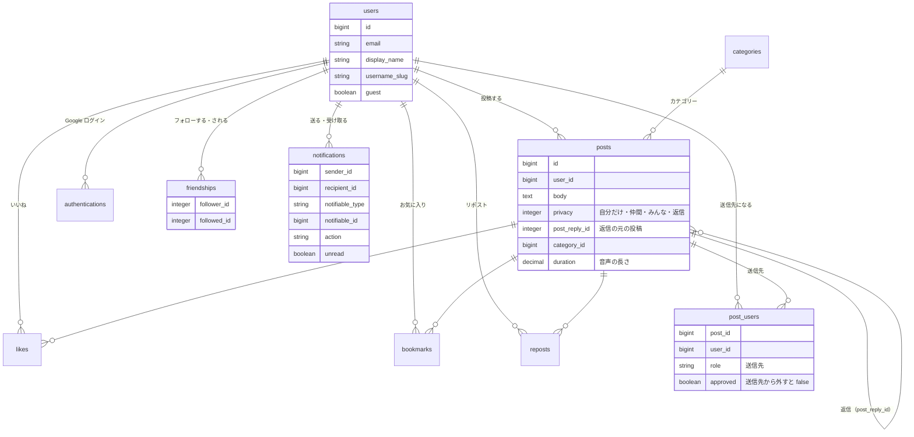

# Watune（ウェーチュン）
音声で、自分と仲間に元気を届け合うアプリです。

- URL：https://www.watune.com
- **お試しログイン**：トップページの「お試しで始める」から、登録なしですぐに使えます（あとから本登録すると、データを引き継げます）
- 主な技術：Ruby on Rails 7.1 / Stimulus・Turbo / React・TypeScript（導入中）/ PostgreSQL / RSpec / Docker（開発・テスト環境）
- インフラ：Render / Neon（PostgreSQL）/ Cloudflare（R2・プロキシ）/ GitHub Actions（CI）

## React・TypeScript の取り組み（導入中）

既存の Rails（Turbo）の画面に、React を少しずつ組み込んでいます。

- **カスタム要素で React を組み込む**：`<react-component name="…" props='…'>` を置くと、その場所に React のコンポーネントが表示される（[entry.tsx](app/javascript/react/entry.tsx)）
- **Turbo と共存させる**：ページ移動・Turbo Frame の差し替え・戻る／進むのどれでも、React を組み立て直し・片付けするようにした
- **Rails から React へデータを渡す**：送信先の候補などを Rails の helper で作り、JSON で渡している
- **型の確認**：esbuild で変換し、型の確認は `yarn typecheck`（`tsc --noEmit`）で別に行う
- 最初のコンポーネント：投稿の編集画面の送信先の選択（[RecipientSelector.tsx](app/javascript/react/components/RecipientSelector.tsx)、PR [#715](https://github.com/shoshoss/pro-watune/pull/715)）

## 最近の取り組み

**セキュリティ**
- Rails の脆弱性（CVE-2026-66066）の暫定対策：https://github.com/shoshoss/pro-watune/pull/720
- 秘密情報（鍵・パスワード）の入れ替え：https://github.com/shoshoss/pro-watune/pull/722
- 非公開の投稿が一覧から見えていた不具合の修正：https://github.com/shoshoss/pro-watune/pull/732
- 非公開の投稿への返信が見えていた不具合の修正：https://github.com/shoshoss/pro-watune/pull/737
- ログインしていなくてもファイルを置けた入口を閉じる：https://github.com/shoshoss/pro-watune/pull/745
- Cloudflare を通ったアクセスで利用者の IP を正しく取る：https://github.com/shoshoss/pro-watune/pull/753

**機能**
- 投稿の編集で、送信先を変えられるようにした：https://github.com/shoshoss/pro-watune/pull/713
- 送信先の選択を React・TypeScript で作り直した：https://github.com/shoshoss/pro-watune/pull/715
- お試しログインを、回数の制限を付けて再開した：https://github.com/shoshoss/pro-watune/pull/747
- 権限確認の漏れを修正：https://github.com/shoshoss/pro-watune/pull/707
- React・TypeScript のビルド環境を構築：https://github.com/shoshoss/pro-watune/pull/709

**開発の進め方**
- CI を約8分から35秒に短縮した：https://github.com/shoshoss/pro-watune/pull/755
- AI（Codex）向けのルール（AGENTS.md）を整備した：https://github.com/shoshoss/pro-watune/pull/742

## 開発の流れ
- Issue を作る → ブランチを作る → develop に PR → develop から main に PR → main が本番（Render）に反映される
- PR には、変更の理由・確認したこと・学んだことを書いています

## 実装済みの機能

| 分類 | 機能 |
|---|---|
| アカウント | 新規登録・ログイン（メール／Google）・お試しログイン（本登録で引き継ぎ）・プロフィールの編集 |
| 投稿 | ブラウザでの録音（MP3 に変換）・再生・文字と音声の投稿・編集・削除・カテゴリー |
| 公開範囲 | 自分だけ・仲間（送信先を選ぶ）・みんな。返信は元の投稿と同じ人にだけ見える |
| つながり | 返信・いいね・お気に入り・リポスト・フォロー・通知 |

※ パスワードの再設定のメールは、本番の環境でメールを送れないため、対応中です（[#729](https://github.com/shoshoss/pro-watune/issues/729)）。

## 今後の候補
- 検索・タグ
- お試しユーザーの自動の片付け（[#741](https://github.com/shoshoss/pro-watune/issues/741)）
- React のコンポーネントのテスト・CI での型の確認
- 投稿ごとの公開範囲のマーク（[#731](https://github.com/shoshoss/pro-watune/issues/731)）

## ER 図

主なテーブルです（`db/schema.rb` から作成）。

音声は Active Storage で Cloudflare R2 に保存しています（`active_storage_blobs`・`active_storage_attachments`）。

## このアプリについて

### サービス概要
本アプリは、音声メッセージを通じて自己肯定感を高め、相互にポジティブなエネルギーを共有することができるプラットフォームです。
ユーザーは自己肯定感を高め、お互いを励ますことで前向きな姿勢を育むことを目指します。

### このサービスへの思い・作りたい理由
これまでの経験の中で、自己肯定感の大切さを身をもって実感しました。
自分自身への感謝や、周りからの応援が力になった経験から、同じような支えを他の人にも届けたいと考え、このアプリを開発しました。

### ユーザー層
本アプリは、自己肯定感を高めたい人々、ポジティブな変化を求める人々を対象としています。
自己改善に意欲的な個人や、コミュニティのサポートを求める人々にとって、有用なツールです。

### サービスの利用イメージ
ユーザーはアプリを使用して、自分の声で感謝や応援メッセージを録音し、自分自身や他者と共有できます。
これにより、自己肯定感の向上と相互のサポートを感じ、前向きに取り組めるようになります。

### 差別化ポイント・推しポイント
他のアプリと異なる本サービスの特徴は、ユーザー間で送り合う心温まる感謝と応援のメッセージにあります。

## 設計資料（企画時・2024年）
- 画面遷移図（Figma）：https://www.figma.com/file/2YTQ4ytdWl1pL92nNYW53W/Fighter-APP?type=design&node-id=0%3A1&mode=design&t=krpjwS74vNt8PdHb-1
